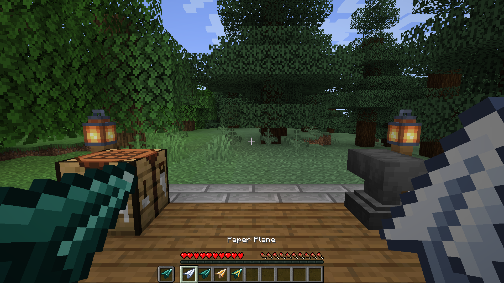
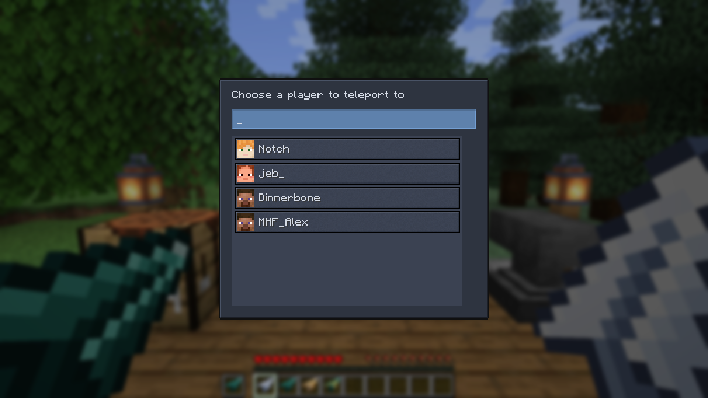
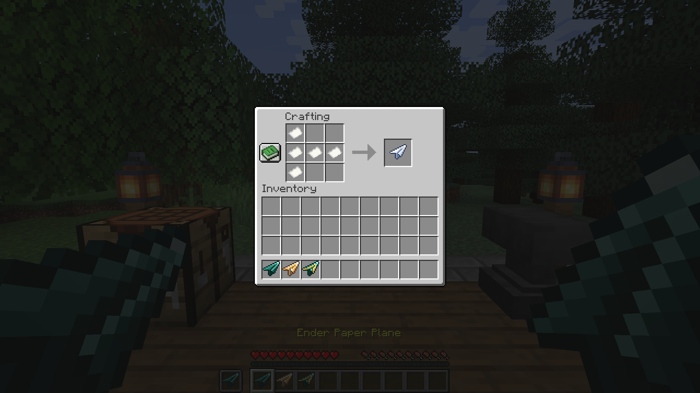

# Paper Plane

<p align="center">
  
</p>

**Paper Plane** turns [FTB Essentials](https://www.curseforge.com/minecraft/mc-mods/ftb-essentials) `/tpa` and `/back` teleports into craftable origami paper plane items — great for survival servers and modpacks that disable public `/tpa` or `/back` commands so teleportation has an in-world crafting cost.



## Items & Recipes

Right-click to use any paper plane (they are activated in hand, not thrown). Single-use planes are **only consumed after a teleport actually completes** — canceled, timed-out, or denied requests never waste an item.

### TPA Paper Planes
- **Paper Plane** *(single-use)*: Opens an online player picker and sends a `/tpa` request through FTB Essentials.
  - *Recipe*: 5 Paper (`P  ` / `PPP` / `P  `).
- **Ender Paper Plane** *(reusable)*: Same player picker and `/tpa` flow, never consumed.
  - *Recipe*: 8 Ender Pearls surrounding 1 Paper Plane.

### Back Paper Planes
- **Back Paper Plane** *(single-use)*: Teleports you back to your previous location using FTB Essentials' teleport history (including your last death spot if FTB Essentials records it).
  - *Recipe*: 4 Bone Meal in a cross around 1 Paper Plane.
- **Ender Back Paper Plane** *(reusable)*: Reusable `/back` paper plane, never consumed.
  - *Recipe*: 8 Ender Pearls surrounding 1 Back Paper Plane.





## Player Picker

- Live search box at the top — type part of a name and press **Enter** when narrowed down to one player to send the request right away.
- Scrollable player list with skin head icons next to each online player.

## Configuration

Edit `config/paper_plane.toml` (reloads automatically without restarting) or use the in-game config screen via Mod Menu (Fabric) / Mods menu (Forge & NeoForge):

| Key | Default | Description |
| --- | --- | --- |
| `enableTpa` | `true` | Enable Paper Plane and Ender Paper Plane. |
| `enableBack` | `true` | Enable Back Paper Plane and Ender Back Paper Plane. |

Cooldowns, warmups, dimension rules, and `/back` history are all controlled by your existing FTB Essentials configuration (`config/ftbessentials.snbt`) — Paper Plane works even when the chat commands themselves are disabled for players.

## Requirements & Supported Versions

Requires **[FTB Essentials](https://www.curseforge.com/minecraft/mc-mods/ftb-essentials)** and **[FTB Library](https://www.curseforge.com/minecraft/mc-mods/ftb-library-forge)**.

| Minecraft | Loaders | Java |
| --- | --- | --- |
| `1.20.1` | Fabric, Forge | 17 |
| `1.21.1` | Fabric, NeoForge | 21 |
| `26.1.2` | Fabric, NeoForge | 25 |

## Building

```bash
./scripts/setup-hooks.sh
./scripts/verify.sh [--container]
```

## License

`GPL-3.0-only` — see [LICENSE](LICENSE).
