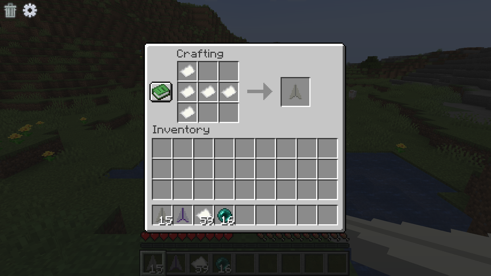
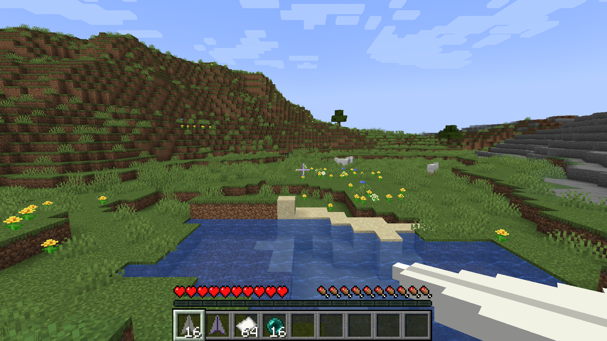
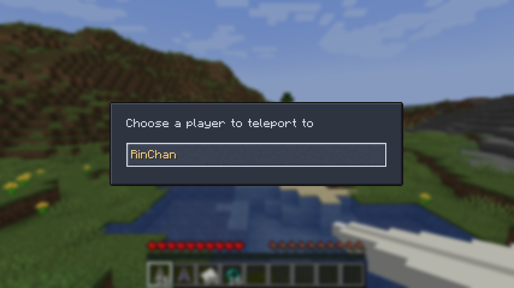
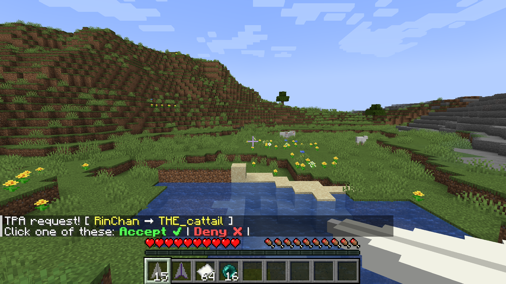
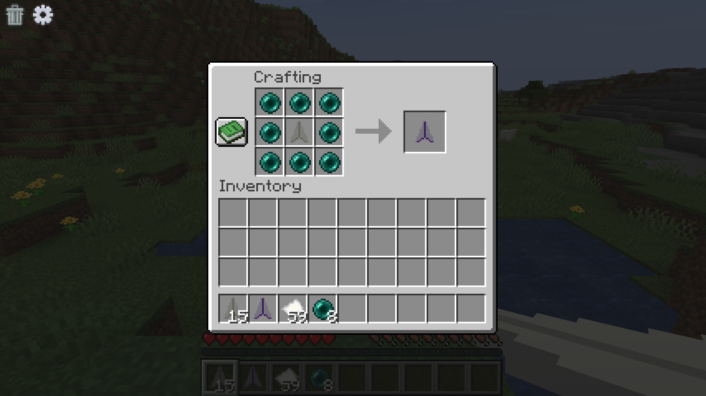

# Paper Plane

Paper Plane lets players use paper planes to send FTB Essentials `/tpa` requests, even when the `/tpa` command is disabled.

Starting in 1.2.0, right-clicking or sneak-right-clicking with any paper plane directly opens the player selection menu; charging, launching, and throwing mechanics have been removed.

## Requirements

- [FTB Essentials](https://www.curseforge.com/minecraft/mc-mods/ftb-essentials)
- [FTB Library](https://www.curseforge.com/minecraft/mc-mods/ftb-library-forge)
- [RinLib](https://modrinth.com/mod/rinlib)

## Screenshots

