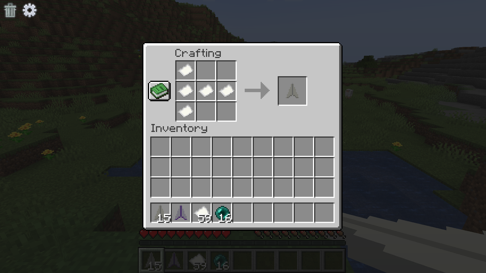
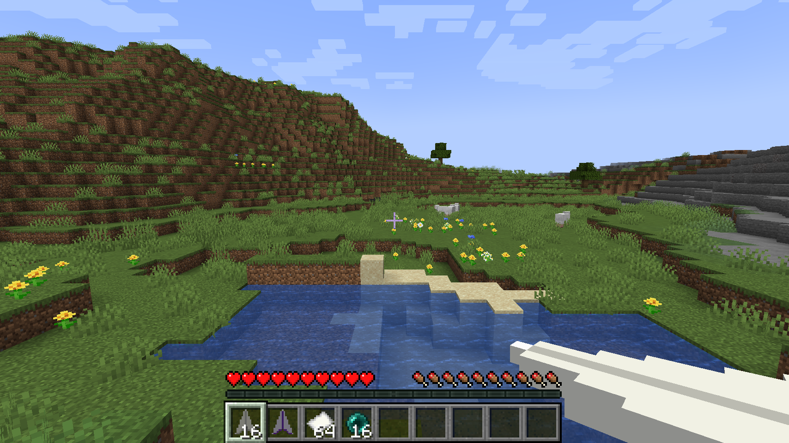
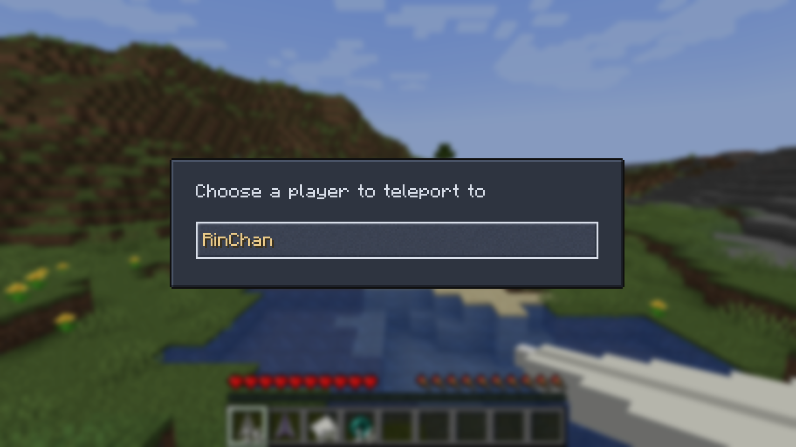
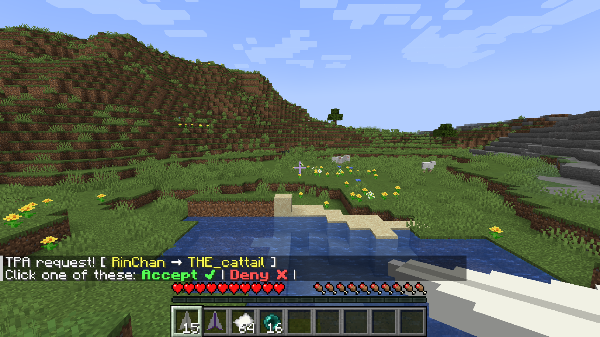
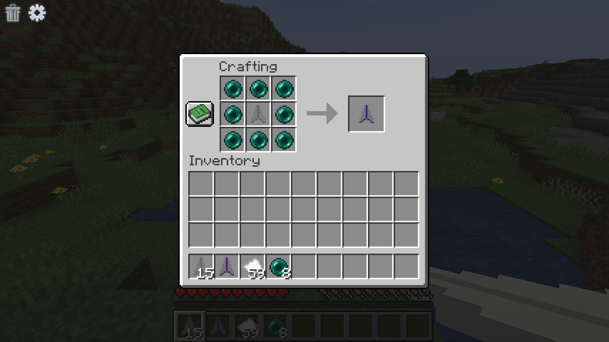

# Paper Plane


Paper Plane turns [FTB Essentials](https://www.curseforge.com/minecraft/mc-mods/ftb-essentials) `/tpa` and `/back` teleports into craftable 3D origami paper plane items — even on servers where public `/tpa` or `/back` commands are disabled.

## Requirements

- [FTB Essentials](https://www.curseforge.com/minecraft/mc-mods/ftb-essentials)
  - Minecraft `1.20.1`: `>=2001.2.4 <2002`
  - Minecraft `1.21.1`: `>=2101.1.10 <2102`
  - Minecraft `26.1.2`: `>=26.1.2.1 <27`
- [FTB Library](https://www.curseforge.com/minecraft/mc-mods/ftb-library-forge)
  - Minecraft `1.20.1`: `>=2001.2.13 <2002`
  - Minecraft `1.21.1`: `>=2101.1.31 <2102`
  - Minecraft `26.1.2`: `>=26.1.1.1 <27`

## Supported Matrix

| Minecraft | Loaders | Java |
|---|---|---|
| `1.20.1` | Fabric, Forge | 17 |
| `1.21.1` | Fabric, NeoForge | 21 |
| `26.1.2` | Fabric, NeoForge | 25 |

## Items & Recipes

All planes are activated directly with a right-click (they are not throwable). Single-use planes are consumed **only after a teleport actually completes** — canceled, denied, or failed teleports never consume an item.

### TPA Paper Planes
- **Paper Plane** *(single-use)*: Right-click to open the online player picker and send an FTB Essentials `/tpa` request.
  - *Recipe*: 5 Paper (`P  ` / `PPP` / `P  `).
- **Ender Paper Plane** *(reusable)*: Same player picker and native `/tpa` request flow, never consumed.
  - *Recipe*: 8 Ender Pearls surrounding 1 Paper Plane.

### Back Paper Planes
- **Back Paper Plane** *(single-use)*: Right-click to return to your previous location using native FTB Essentials teleport history.
  - *Recipe*: 4 Bone Meal in a cross around 1 Paper Plane.
- **Ender Back Paper Plane** *(reusable)*: Right-click to return to your previous location, never consumed.
  - *Recipe*: 8 Ender Pearls surrounding 1 Back Paper Plane.

### Player Picker UI
- Scrollable player list that cleanly handles servers of any size.
- Player skin head avatars rendered beside each name.
- Live case-insensitive search bar at the top — press **Enter** when narrowed to a single player to send immediately.

## Screenshots











## Configuration

Settings live in `config/paper_plane.toml` (hot-reloaded automatically on edit — no restart required) and can also be edited in-game via the native Config Screen (Mod Menu on Fabric, Mods menu on Forge / NeoForge).

| Key | Default | Effect |
|---|---|---|
| `enableTpa` | `true` | Enables Paper Plane and Ender Paper Plane. |
| `enableBack` | `true` | Enables Back Paper Plane and Ender Back Paper Plane. |

These switches operate independently of whether public `/tpa` or `/back` commands are enabled in FTB Essentials.

### FTB Essentials Teleport Settings

Paper Plane defines no second cooldown or warmup. All cooldowns, warmups, dimension restrictions, and teleport history rules remain native to FTB Essentials (`config/ftbessentials.snbt`).

## Localization

Includes built-in translations for:
- English (`en_us`)
- Simplified Chinese (`zh_cn`)
- Traditional Chinese (`zh_tw`)
- Japanese (`ja_jp`)

## Building & Verification

Enable the local `pre-push` verification hook once per clone:

```bash
./scripts/setup-hooks.sh
```

Run the full verification suite (6-target build matrix, property-based invariant tests, packaged-JAR architecture contracts, client `TeleportPlayerScreen` black-box test, and packaged-JAR Minecraft `1.21.1` NeoForge GameTest E2E with FTB Library + FTB Essentials). Pass `--container` (or omit JDK 17/21/25 on the host) to run inside `Dockerfile.verify`:

```bash
./scripts/verify.sh [--container]
```

## License

`GPL-3.0-only` — see [LICENSE](LICENSE).
